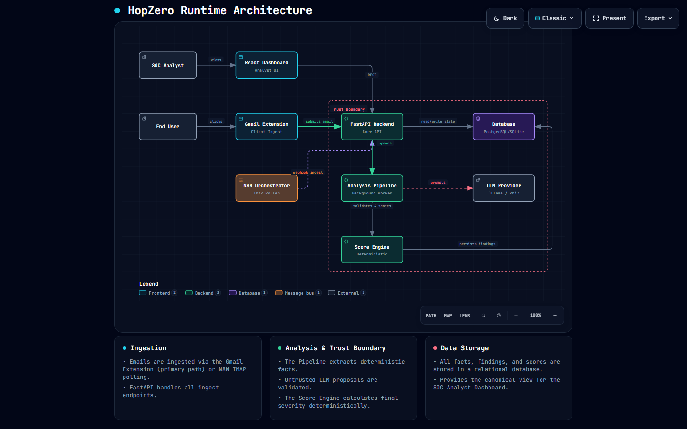

<div align="center">

# 🚀 HopZero

**Air-Gapped Email Threat Forensics & BotChain Tool Suite**

[](CHANGELOG.md)
[](pyproject.toml)
[](https://github.com/djbdvt-maker/Email_Analyser-/actions/workflows/ci.yml)
[](LICENSE)
[](docs/TELEMETRY.md)
[](05_QA/golden/golden_outputs.json)

[**Quickstart**](#-quickstart-per-os) • [**Remote Deployment**](#-remote-multi-network-deployment) • [**Architecture**](#-system-architecture) • [**5-Level Disclosure**](#-5-level-progressive-disclosure) • [**Employee Portal**](#-employee-portal--management) • [**Browser Extension**](#-analyst--employee-browser-extension) • [**BotChain Tools**](#-botchain-studio--tool-chaining) • [**Documentation**](docs/)

</div>

---

## 📖 Overview

**HopZero** is an enterprise-grade digital email forensics and incident response (DFIR) platform engineered for security operations center (SOC) analysts, digital forensics teams, and distributed enterprise workforces.

Unlike opaque cloud scanners or generative AI black-boxes, HopZero is engineered with strict **on-premises determinism** and cryptographic accountability:

- **🔒 100% On-Premises Privacy**: Operates fully offline by default with zero external data telemetry. Analyzed emails, credentials, and forensic telemetry never leave your host perimeter.
- **🎯 Deterministic Threat Scoring**: Threat scores are strictly calculated by a compiled 43-qualification registry across 9 capped buckets and 6 critical category floors (`CF-01` through `CF-06`). The golden regression suite guarantees byte-identical reproducibility on baseline test cases.
- **🛡️ Zero LLM Scoring Authority**: Advisory reasoning (`hermes3:3b`) operates behind a rigid 4-gate trust boundary at zero temperature; generative models cannot alter risk scores or trigger mitigation floors.
- **📜 Courtroom-Grade Forensic Evidence**: Generates cryptographic SHA-256 hash chains and custodial audit trails structured to support Section 63 Bharatiya Sakshya Adhiniyam (BSA) / Section 65B Indian Evidence Act certification processes (*HopZero does not certify legal admissibility*).
- **🌐 Zero-Config Multi-Network Support**: Single-command launcher with automated HTTPS reverse tunneling (`cloudflared`) to connect remote employees and distributed analysts without complex firewall or VPN configuration.

---

## 🚀 Quickstart per OS

HopZero runs natively on bare metal—**no Docker required**.

### Windows (Command Prompt or PowerShell)
```cmd
git clone https://github.com/djbdvt-maker/Email_Analyser-.git hopzero
cd hopzero
hopzero.bat
```
*(Or in PowerShell: `.\hopzero.ps1`)*

### Linux (Ubuntu, Debian, RHEL, Fedora)
```bash
git clone https://github.com/djbdvt-maker/Email_Analyser-.git hopzero
cd hopzero
chmod +x hopzero.sh
./hopzero.sh
```

### macOS (Apple Silicon M1–M4 / Intel)
```bash
git clone https://github.com/djbdvt-maker/Email_Analyser-.git hopzero
cd hopzero
chmod +x hopzero.sh
./hopzero.sh
```

### Universal Python Launcher
```bash
python scripts/launch.py
```

The launcher will automatically:
1. Verify system prerequisites and auto-profile host hardware.
2. Allocate conflict-free ports (Backend `8000+`, Frontend `5173+`).
3. Run embedded database migrations with automatic pre-upgrade backups.
4. Warm up the resident local Ollama model (`hermes3:3b`).
5. Open your default browser directly into the SOC analyst workspace.

---

## 🌐 Remote Multi-Network Deployment

Need to analyze emails from remote employee laptops or across distributed networks without configuring routers or firewalls? HopZero includes built-in zero-config public tunneling via Cloudflare Quick Tunnel:

| Platform | Command |
| :--- | :--- |
| **Windows (CMD)** | `hopzero-remote.bat` |
| **Windows (PowerShell)** | `.\hopzero-remote.ps1` |
| **Linux / macOS** | `./hopzero-remote.sh` |
| **Python CLI** | `python scripts/launch.py --remote` |

This spins up the complete backend, frontend, and a secure public HTTPS endpoint (`https://*.trycloudflare.com`) with automated token authorization, enabling remote employee submissions and analyst access anywhere.

---

## 🏗️ System Architecture



```
                                  UNTRUSTED INCOMING EVIDENCE
                                    (.eml / .msg MIME Files)
                                               │
                                               ▼
┌───────────────────────────────────────────────────────────────────────────────────────────┐
│                              SUBPROCESS PARSER SANDBOX                                     │
│  • Memory Limit: 100 MB       • Timeout: 15 seconds        • Archive Depth: <= 2          │
│  • Attachment Limit: <= 50    • Decompression Ceiling: 10 MB                               │
└─────────────────────────────────────────────┬─────────────────────────────────────────────┘
                                               ▼
                                  NORMALIZED FORENSIC FACTS
                       (Header Lineage, Authentication, Extracted URLs)
                                               │
                      ┌────────────────────────┴────────────────────────┐
                      ▼                                                 ▼
┌──────────────────────────────────────────┐     ┌──────────────────────────────────────────┐
│      DETERMINISTIC FORENSIC COMPILER     │     │       4-GATE TRUST BOUNDARY (LLM)        │
│  • 43-Qualification Registry             │     │  • Resident Model: hermes3:3b            │
│  • 9 Capped Severity Buckets             │     │  • Context: 4096 tokens, temp=0.0        │
│  • Hard Category Floors (CF-01 .. CF-06) │     │  • Zero Scoring Authority Invariant      │
│  • Output: Exact Deterministic Score     │     │  • Output: Advisory Summary & Hypotheses │
└────────────────────┬─────────────────────┘     └─────────────────────┬────────────────────┘
                      └────────────────────────┬────────────────────────┘
                                               ▼
┌───────────────────────────────────────────────────────────────────────────────────────────┐
│                                 PROGRESSIVE DISCLOSURE UI                                 │
│  L1: Consumer Verdict  │  L2: Why & Action  │  L3: Technical Evidence                     │
│  L4: 43-Qualification Findings  │  L5: Audit Trail & Section 63 BSA Evidence Package      │
└─────────────────────────────────────────────┬─────────────────────────────────────────────┘
                                               ▼
┌───────────────────────────────────────────────────────────────────────────────────────────┐
│                              BOTCHAIN STUDIO TOOL SUITE APIs                              │
│  • hopzero_inspect_email_forensics  • hopzero_extract_artifacts  • hopzero_verify_dkim    │
│  • hopzero_score_threat             • hopzero_generate_action_drafts                      │
└───────────────────────────────────────────────────────────────────────────────────────────┘
```

---

## 🛡️ 5-Level Progressive Disclosure

HopZero accommodates every stakeholder tier—from non-technical staff to frontline SOC teams and courtroom forensic expert witnesses:

| Level | Target Audience | Primary Artifacts |
| :--- | :--- | :--- |
| **Level 1: Consumer Verdict** | End-users, Employees | Plain-English safety badge (`SAFE`, `SUSPICIOUS`, `DANGEROUS`), numeric risk score. |
| **Level 2: Why & Action** | Frontline Helpdesk, SOC T1 | Key threat indicators, human-authorized `ActionDrafts` (quarantine, block sender, isolate IP). |
| **Level 3: Technical Evidence** | SOC Analysts, Incident Responders | Received-hop transit lineage, SPF/DKIM/DMARC matrix, lookalike domain distance. |
| **Level 4: 43-Qualification Findings** | Senior Forensics, Threat Engineers | Raw rule triggers, 9-bucket score breakdown, category floors, RFC anomalies. |
| **Level 5: Audit & Export** | Legal Counsel, Compliance, Court | Exact SHA-256 reproducibility fingerprint, custodial log, Section 63 BSA evidence bundle. |

---

## 👥 Employee Portal & Management

HopZero includes a dedicated **Zero-Trust Employee Portal** (`/portal`) tailored for corporate workforces:

- **Simple Submissions**: Non-technical staff upload suspicious emails or paste raw headers with drag-and-drop simplicity.
- **Privacy Partitioning**: Employees see clear, jargon-free safety verdicts without exposing sensitive SOC threat intel, server logs, or infrastructure telemetry.
- **Admin Management Panel**: SOC administrators can generate invite links, manage employee access tokens, review submission queues, and revoke credentials at `/admin`.

---

## 🧩 Analyst & Employee Browser Extension

The HopZero Chrome/Edge/Firefox extension (`07_EXTENSION`) provides real-time webmail defense right inside Gmail and Outlook:

- **Webmail DOM Inspector**: Scans active webmail messages in real time.
- **Direct Backend Hook**: Dispatches suspicious emails to HopZero backend instances over local network or remote HTTPS tunnel.
- **Analyst Action Feedback**: Triggers triage reviews and fetches grounded remediation actions from the browser popup.

### Packaging & Installing Extension
```bash
# Package the extension into a distributable zip
python scripts/package_extension.py

# Or package with pre-configured remote hub URL
python scripts/package_extension.py --hub-url https://your-hopzero-instance.com
```
1. Open Google Chrome or Microsoft Edge and navigate to `chrome://extensions/`.
2. Toggle **Developer mode** in the upper right.
3. Click **Load unpacked** and select the `07_EXTENSION` directory (or extract `dist/hopzero-employee-extension.zip`).

---

## 🤖 BotChain Studio & Tool Chaining

HopZero exposes a modular suite of forensic tools available via REST API and ready for autonomous agentic workflows or [n8n Automation](06_N8N/):

- **`hopzero_inspect_email_forensics`**: Performs end-to-end sandbox parsing and extracts normalized forensic facts.
- **`hopzero_extract_artifacts`**: Isolates headers, attachments, embedded URLs, and routing hops.
- **`hopzero_verify_dkim`**: Validates cryptographic signature authenticity and key parameters.
- **`hopzero_score_threat`**: Computes pure deterministic risk scoring across the 43-qualification registry.
- **`hopzero_generate_action_drafts`**: Produces human-gated mitigation recommendations (`ActionDrafts`).

---

## 🩺 System Diagnostics (`doctor`)

HopZero provides a self-healing diagnostic engine to verify runtime dependencies and baseline integrity before running in production:

```bash
python scripts/doctor.py
```

Checks performed:
- Python 3.12.x pinned runtime & virtual environment health.
- Node.js & Vite build artifacts.
- Disk capacity & app-data permissions.
- SQLite WAL mode & database connection.
- Ollama resident daemon & `hermes3:3b` model weights.
- Qualification registry cryptographic SHA-256 integrity (`01_REGISTRY`).
- Deterministic golden regression baseline match.

---

## 📂 Repository Layout

```
.
├── 01_REGISTRY/          # Authoritative 43-qualification registry & compiler
├── 02_FORENSICS/         # Pure air-gapped forensic analyzers (SPF/DKIM/DMARC/Routing)
├── 03_BACKEND/           # FastAPI backend, DB migrations, WebSockets, Tool Chaining
├── 04_FRONTEND/          # React + Vite + TypeScript SOC workspace & Employee Portal
├── 05_QA/                # Deterministic golden regression suite & RFC fixtures
├── 06_N8N/               # Workflow automation definitions & SOAR integration
├── 07_EXTENSION/         # Manifest V3 browser extension for Gmail & Webmail
├── 07_TEST_DATA/         # Raw RFC 5322 EML/MSG test sample corpus
├── 08_FINETUNING/        # LoRA finetuning recipes & datasets for advisory reasoning
├── docs/                 # Architecture, threat model, compliance & design specifications
└── scripts/              # Launchers, doctor, tunnel, golden verification & packaging
```

---

## 🧪 Testing & Verification

HopZero guarantees deterministic zero-drift execution across operating systems:

```bash
# Verify golden regression deterministic baseline
python scripts/check_golden.py

# Verify air-gapped network isolation (zero remote sockets)
python scripts/test_network_isolation.py

# Execute end-to-end clean install smoke test
python scripts/smoke_test.py

# Run full test suite
pytest
```

---

## 💻 Support Matrix & Hardware Editions

### Supported Operating Systems
- **Windows**: Windows 10 (21H2+), Windows 11, Windows Server 2022+ (x86_64)
- **Linux**: Ubuntu 22.04+, Debian 12+, RHEL/Rocky 9+ (x86_64, aarch64)
- **macOS**: macOS 13 Ventura, 14 Sonoma, 15 Sequoia (Apple Silicon M1–M4 & Intel x86_64)

### Hardware Editions
HopZero auto-detects host hardware and recommends an optimized tier:
- **Lite**: &lt;8 GB RAM or &lt;=4 CPU cores. WAL SQLite, aggressive pre-screening, offline deterministic fallback.
- **Standard**: 8–16 GB RAM, entry GPU or integrated graphics. WAL SQLite, resident Ollama `hermes3:3b`.
- **Pro**: &gt;=16 GB RAM, dedicated NVIDIA GPU (&gt;=4 GB VRAM). WAL SQLite / PostgreSQL, full GPU acceleration.
- **Server**: Multi-user headless server (&gt;=32 GB RAM). PostgreSQL database, enterprise worker pools.

---

## ⚠️ Known Limitations & Operational Bounds

To safeguard hosts against malicious denial-of-service and parser exhaustion exploits, the following bounds are strictly enforced:
1. **MIME Archive Recursion**: Unpacking recursion depth is capped at `<= 2` nested archives.
2. **Decompression Ceiling**: ZIP and archive uncompressed size limit is capped at `10 MB`.
3. **Attachment Count**: A maximum of `50` attachments are extracted per email message.
4. **Single Local Model**: Inference is locked to `hermes3:3b` (`Q4_K_M`, 4096 ctx) to maintain low memory footprints and guarantee reproducibility across installations.

---

## ⚖️ What HopZero Does Not Guarantee

- **Legal Admissibility**: HopZero generates structured evidence packages with cryptographic hash chains, but does not provide legal representation; evidentiary admissibility remains subject to judicial discretion and jurisdictional rules.
- **Novel Evasion / Zero-Days**: Threat scoring is strictly bounded by observable technical signals. Novel evasions or zero-day exploits with no extractable indicators may not trigger elevated scores.
- **Total Air-Gap Isolation Under All Configurations**: While default operation is fully local and offline, optional features (e.g. sandbox browser capture, external reputation enrichment) make outbound network requests when explicitly configured.

---

## 🔒 Security & Legal Governance

- **Vulnerability Disclosure**: Review [SECURITY.md](SECURITY.md) for triage SLAs and disclosure protocols.
- **Contributing Guidelines**: Review [CONTRIBUTING.md](CONTRIBUTING.md) for the mandatory zero-drift golden regression policy.
- **Threat Model**: Detailed STRIDE analysis documented in [docs/THREAT_MODEL.md](docs/THREAT_MODEL.md).
- **Responsible Use**: Defensive incident response positioning detailed in [docs/RESPONSIBLE_USE.md](docs/RESPONSIBLE_USE.md).
- **Statutory Admissibility**: Hash-verified, auditable evidence packages are structured to support the applicable Section 63 BSA / Section 65B IEA certification process; *HopZero does not certify legal admissibility*. See [docs/TERMS_OF_SERVICE.md](docs/TERMS_OF_SERVICE.md).

---

## 📝 License

Distributed under the **Apache License, Version 2.0**. See [LICENSE](LICENSE) and [NOTICE](NOTICE) for complete terms and third-party attributions.
